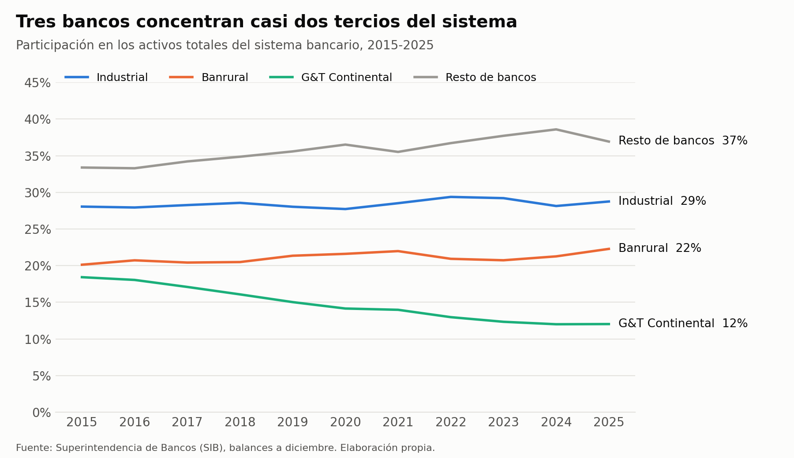
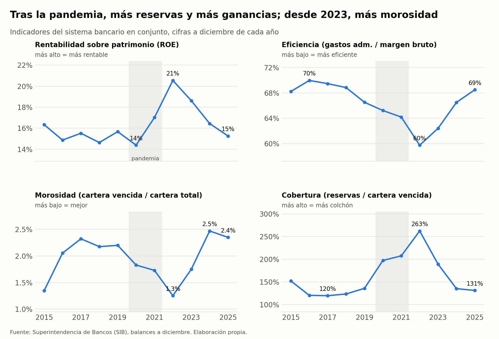
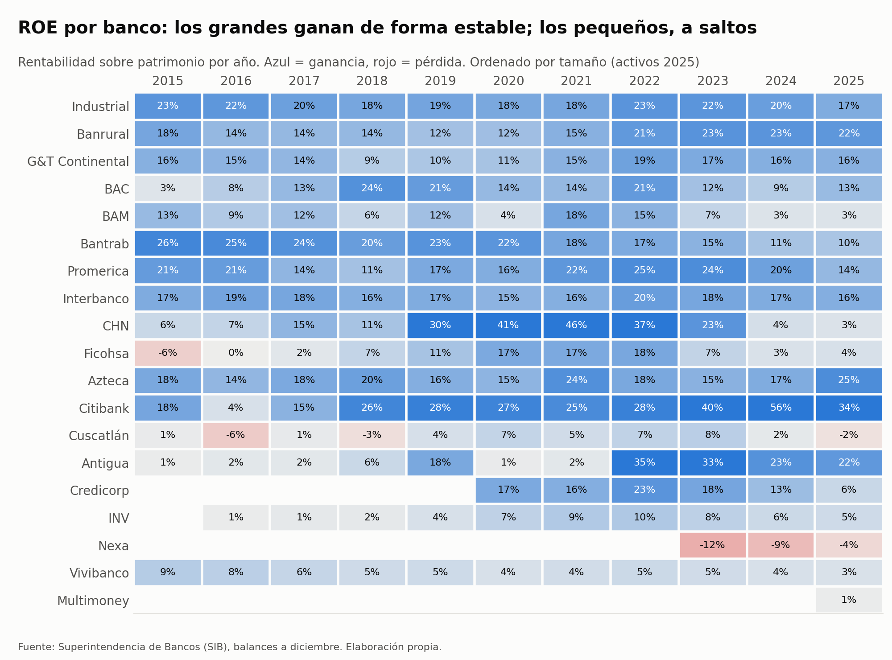
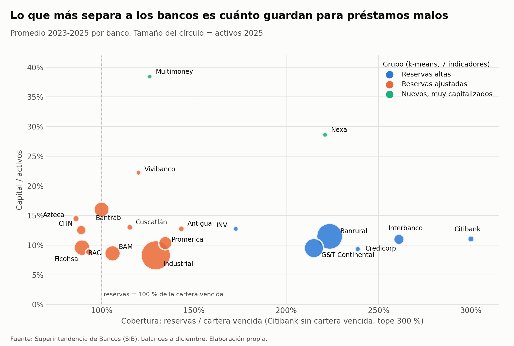

# Salud y competencia del sistema bancario de Guatemala, 2015-2025

Análisis de los 19 bancos que operan en Guatemala a partir de sus balances y estados de resultados públicos (Superintendencia de Bancos, SIB). Calculo rentabilidad, eficiencia, calidad de cartera y concentración del mercado, y agrupo a los bancos por perfil financiero con k-means.

**Herramientas:** Python (pandas, scikit-learn, matplotlib) · SQL (DuckDB) · Git

## Hallazgos principales

### 1. Tres bancos tienen el 63 % de los activos, y el orden entre ellos cambió


- El mercado está **moderadamente concentrado**: el índice Herfindahl-Hirschman (HHI) se ha mantenido entre 1,630 y 1,710 toda la década.
- **G&T Continental pasó de 18 % a 12 %** del sistema. Sus activos crecieron 58 % en 10 años, mientras que el sistema creció 143 %.
- **Banrural subió de 20 % a 22 %** e Industrial se mantuvo cerca de 28-29 %.

### 2. La pandemia no golpeó a los bancos; el deterioro llegó después


- En 2020-2022 los bancos **duplicaron su cobertura**, de 136 % a 263 % de la cartera vencida, y aun así el ROE subió a su máximo de la década (21 % en 2022).
- Desde 2023 el ciclo se invierte: **la morosidad casi se duplicó**, de 1.25 % en 2022 a 2.47 % en 2024; la cobertura bajó a 131 % y la eficiencia empeoró de 60 % a 69 %.
- Por eso el ROE de 2025 (15 %) volvió al nivel de antes de la pandemia.

### 3. Los grandes son estables; varios medianos perdieron rentabilidad


- **Industrial, Banrural, G&T e Interbanco** se mantienen entre 15 % y 23 % de ROE casi todos los años.
- **BAM** bajó de 18 % (2021) a 3 % (2024-2025), y **Bantrab** de 26 % (2015) a 10 % (2025).
- **CHN** quintuplicó sus activos (de Q3.1 a Q15.4 miles de millones) y tuvo ROE de 30-46 % en 2019-2022. Desde 2024 está en 3-4 %, con la morosidad más alta del sistema (5.8 %).

### 4. Tres perfiles de banco


Hice k-means con 7 indicadores estandarizados (ROA, eficiencia, morosidad, cobertura, capital/activos, cartera/depósitos y liquidez), usando el promedio 2023-2025 de cada banco:

| Grupo | Bancos | ROA | Eficiencia | Cobertura | Cartera / depósitos |
|---|---|---|---|---|---|
| **Reservas altas** | Banrural, G&T, Interbanco, Citibank, Credicorp, INV | 2.1 % | 60 % | 235 % | 51 % |
| **Reservas ajustadas** | Industrial, BAC, BAM, Bantrab, Promerica, CHN y 5 más | 1.4 % | 86 % | 110 % | 86 % |
| **Nuevos, muy capitalizados** | Nexa, Multimoney | -1.3 % | 118 % | 174 % | 139 % |

Los bancos con reservas altas **prestan una proporción menor de sus depósitos, son más eficientes y más rentables**. Los de reservas ajustadas operan con un colchón de alrededor de 100 % de la cartera vencida, así que un aumento de la morosidad les pega más directo en resultados.

## Metodología

| Indicador | Fórmula |
|---|---|
| ROA | utilidad neta / activo promedio (cierre actual y anterior) |
| ROE | utilidad neta / capital contable promedio |
| Eficiencia | gastos de administración / margen operacional bruto (más bajo = mejor) |
| Morosidad | cartera vencida / cartera bruta |
| Cobertura | estimaciones por valuación de cartera / cartera vencida |
| HHI | suma de las participaciones de activos al cuadrado (en %) |

- Los datos son los cortes a **diciembre de cada año**. El estado de resultados de la SIB es acumulado en el año; el código anualiza la utilidad (× 12 / mes) para poder agregar cortes mensuales más adelante.
- La limpieza valida que activo = pasivo + capital, y que la utilidad del estado de resultados coincida con la del balance, en cada banco y cada año.
- **Fusiones:** Promerica de Guatemala se integra a Promerica en 2018. Banco de Crédito deja de reportar en 2019. Se mantienen como entidades separadas en la serie.

**Limitaciones**
- **Ficohsa 2025:** su margen operacional bruto es casi nulo, así que la eficiencia no tiene sentido económico. En el clustering se topó en 150 %.
- **Citibank:** no tiene cartera vencida. En el clustering su cobertura se fijó en el tope de 300 %.
- **Clustering:** el coeficiente de silueta es más alto con k=2 (0.42) que con k=3 (0.26). Usé k=3 porque separa a los dos bancos nuevos, que de otro modo distorsionan los promedios, pero los grupos no están nítidamente separados.
- **Cartera vencida:** sigue la definición contable del balance publicado. Puede diferir del indicador de morosidad que la SIB publica por separado.

## Estructura
```
data/raw/         archivos descargados de la SIB (sin modificar)
data/processed/   balances.csv (formato largo), kpis.csv, sistema.csv, concentracion.csv, clusters.csv
sql/kpis.sql      vistas de indicadores en DuckDB
src/limpiar.py    lectura y validación de los archivos de la SIB
src/kpis.py       carga a DuckDB y cálculo de indicadores
src/clusters.py   k-means y PCA
src/graficas.py   figuras del reporte
reports/figuras/  gráficas finales
```

## Cómo reproducir
```bash
python3 -m venv .venv && .venv/bin/pip install -r requirements.txt
.venv/bin/python src/limpiar.py
.venv/bin/python src/kpis.py
.venv/bin/python src/clusters.py
.venv/bin/python src/graficas.py
```

Para actualizar los datos: en la [consulta dinámica de la SIB](https://www.sib.gob.gt/ConsultaDinamica/?cons=7) (Balance General y Estado de Resultados, Instituciones Bancarias), descarga el corte que quieras y guárdalo en `data/raw/`. El script toma la fecha del contenido del archivo, así que el nombre no importa.

## Datos
Superintendencia de Bancos de Guatemala. Información pública. Cifras en miles de quetzales.
